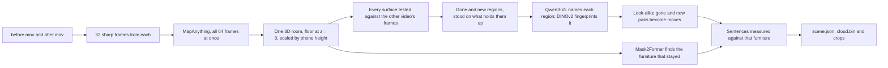

# What changed in the room

Give it two phone videos of the same room, one filmed before you rearranged it and one after. It builds a single 3D model from both and finds the things that moved, appeared or disappeared, then describes each one in a plain sentence. The viewer at `/changes` in the web app shows the shared model with every change boxed, the photos each box came from, and the parts of the room that only one video saw.


## Run it

You need macOS on Apple silicon (the local vision model runs on MLX), [uv](https://docs.astral.sh/uv/), ffmpeg and Node 20.9+. The first run downloads about 15 GB of model weights into `~/.cache`.

```bash
scripts/changes/setup.sh                       # builds packages/changes/.venv with the models' dependencies

packages/changes/.venv/bin/room-changes run before.mov after.mov \
  --camera-height 1.4 \
  --out apps/web/public/changes/my-room         # two to four minutes on an M-series laptop

cd apps/web && npm run dev                      # then open http://localhost:3000/changes?room=my-room
```

The terminal prints the same sentences the viewer shows. This is the living-room example:

```text
5 things changed between the videos: the armchair moved 2.8 m, the stool moved 2.9 m, the potted plant was removed, a cardboard box appeared and a basket appeared.
  c1  moved    The armchair moved 2.8 m from between the bookshelf and the coffee table to the other side of the coffee table and turned about 165° clockwise. (about 90 cm by 85 cm and 1.0 m tall)
  c2  moved    The stool moved 2.9 m from near the coffee table to beside the bookshelf. (about 45 cm by 40 cm and 45 cm tall)
  c3  removed  The green leafy plant in terracotta pot beside the bookshelf is gone. (about 55 cm by 55 cm and 1.3 m tall)
  c4  added    A beige cardboard box appeared beside the coffee table. (about 55 cm by 45 cm and 35 cm tall)
  c5  added    A woven natural fibre basket appeared on the coffee table. (about 35 cm by 30 cm and 15 cm tall)
```

| Option | What it does |
|---|---|
| `--camera-height 1.4` | How high you held the phone, in metres. It corrects the reconstruction's scale, which otherwise ran 6 to 17% large on the examples. Leave it out if you don't know. |
| `--fov 69` | The video's horizontal field of view in degrees, if you know it. Left out, the model estimates it. |
| `--rotate 90` | Turn every frame clockwise by this many degrees, for a video that doesn't record which way is up. Videos from the iPhone camera app do. |
| `--frames 32` | Frames taken from each video, each the sharpest of its stretch. |
| `--namer none` | Skip the vision model. Changes are still found, boxed and placed against the furniture, but each one is called "object". |
| `--fresh` | Reconstruct again instead of reusing the cached result in `~/.cache/sp-changes`. |

### Filming your own pair

Walk slowly around the room at chest height for 15 to 30 seconds, keeping the floor in frame. Film the second video on a different path but over the same area. A spot only one video saw is shown as a blind spot and never reported, so overlap matters more than length. Changes need to be at least about 10 cm across to count (see the tradeoffs).

To test on a walk you already have, `scripts/changes/capture_pair.py` cuts two stretches of one Standard Physics capture into an upright before and after pair, with ARKit's camera track as the truth for the scorer.

## Examples and how they score

Each example is a pair of six-second handheld walkthroughs rendered in Blender from CC0 Poly Haven models by [`render_example_room.py`](../../scripts/changes/render_example_room.py), using the rooms in [`example_scenes.py`](../../scripts/changes/example_scenes.py). The footage imitates a phone: the camera shakes and rolls, the shutter blurs motion and reads the sensor top to bottom, the exposure drifts, and the video carries grain and compression. The inputs live in [`datasets/changes`](../../datasets/changes), the outputs in [`apps/web/public/changes`](../../apps/web/public/changes), and the viewer switches between them.

| Room | What it tests | Result |
|---|---|---|
| Living room | Two moves, a removal and two additions, one of them on a table | 5 of 5 found, none false, 5 of 5 named right |
| Studio | A different room, furniture and pair of paths, held out until the detector was finished | 5 of 5 found, none false, 4 of 5 named right |
| Nothing changed | The living room twice from different paths | Nothing reported |
| Blind spot | The before walk never looks at half the room, and a crate appears in that half | The armchair's move found; the crate not reported |

A rendered room comes with exact answers. `truth.json` records every object's box in both videos and every camera pose, and `room-changes evaluate` scores a result against it. It lines the estimated camera path up with the true one and matches each true change to a reported one of the same type within 50 cm. Errors are measured in the reconstruction's own metres, after the camera-height correction, as a person reading the sentences would meet them. The figures below average every before and after box:

```bash
packages/changes/.venv/bin/room-changes evaluate apps/web/public/changes/studio datasets/changes/studio/truth.json
```

| Measure | Living room | Studio |
|---|---|---|
| Box centre error on the floor | 4.9 cm | 13.7 cm |
| Box bottom error | 2.0 cm | 2.7 cm |
| Box height error | 4.5 cm | 2.7 cm |
| 3D overlap with the true box | 0.69 | 0.55 |
| Distance moved, error | 5.5 cm | 5.5 cm |
| Turn of the armchair | 5° off | exact |
| Camera path error | 1.9 cm | 2.5 cm |

The studio's two weak spots are both in the record. The wooden crate sat beside the before walk's path, so that video only saw one end of it; its box covers that end, sits 47 cm from the crate's centre, and the vision model called the end "a wooden step". The ottoman is nearly the same shape end to end, and the turn came out 60° one way when it was 90° the other. That is 30° off if its two ends count as alike, and 150° if not.

[`tests/test_change_examples.py`](tests/test_change_examples.py) re-scores all four checked-in results on every test run, so regenerating an example with a worse detector fails the build.

### Real phone footage

The rendered rooms are the only footage with exact answers. As a check on real video, two stretches of the Share Tea walkthrough, a real iPhone capture of a shop that is not in this repository, were cut 30 seconds apart where both look along the same counter. Nothing was staged between them, and ARKit's camera track gives true metres. The reconstruction tracked the camera to within 8.9 cm and came out 17% large without a camera height. The first version of the detector reported two of the counter's open-frame stools as removed. From some angles the after video sees through the gaps in a stool, so a stool reads as partly empty. Requiring 85% of all sightlines into a region to see empty space removed both, and the pair now reports nothing, which is right for a scene where nothing moved. A real before and after pair with staged changes and hand-measured truth is the obvious next example to add.

## How it works



1. **One reconstruction, not two.** All frames from both videos go through [MapAnything](https://github.com/facebookresearch/map-anything) in a single pass. The furniture that did not move ties the two walks together, so there is no separate registration step to get wrong. The room is turned so the floor sits at z = 0 and the walls line up with the axes, and the phone's median height above the floor rescales it to the height you gave.
2. **Seeing through, not differencing.** Each surface point from the before video is projected into every after frame. If the after camera's depth lands on the point, the surface is still there. If the camera saw farther than the point, its line of sight passed through where the point was, which is evidence that it is gone. If something nearer blocked the view, or no frame pointed that way, the after video says nothing about the point. The same test runs the other way for new things. This third answer is what keeps a different viewpoint, an occluded corner or a spot only one video saw from turning into a change, and the viewer hatches those spots instead.
3. **Regions.** Points that several frames saw through are grouped into connected regions, grown through neighbours the other video never contradicted, and fitted with upright boxes. A region survives only if 85% of all sightlines into it saw empty space. Its box then stands on the floor or the table top underneath, because within about 15 cm of a support depth can't tell an object's base from what it rests on.
4. **Names and matches.** Qwen3-VL, running locally, names each region from its clearest frame. DINOv2 turns the region's pixels into an appearance fingerprint. A gone region and a new one that look alike, are of similar size and sit at least 15 cm apart become one move. The turn is the yaw that best lays the old shape onto the new one, and it is left out when the shape looks the same turned.
5. **Words from geometry.** Mask2Former labels the furniture in the before frames, the labels are voted onto the 3D points, and each unchanged piece gets a box and a name nothing else in the room shares. "On the coffee table", "between the bookshelf and the coffee table" and "to the other side of the coffee table" are computed from those boxes, so a sentence never places an object somewhere the 3D model does not.

## Tradeoffs

- **A change needs a second look.** It counts only where the other video saw through the old or new spot, from several frames. That keeps false alarms down, but a change the second video never pointed at goes unreported. `coverage` in `scene.json` and the bars in the viewer say how much of each video the other one checked.
- **Thin and small things are filtered out.** Regions under 10 cm across their footprint or under about 150 surface points are dropped, along with pixels at the frame edge and within 40 cm of the lens. Each of these filters removed a false alarm on the living room, where every one was a sliver along a silhouette or a smear at the frame edge. A broom or a frame leaning on a wall would be missed.
- **The scale needs a hint.** MapAnything predicts metric depth, but its scale came out 6 to 11% large on the rendered rooms and 17% large on the real counter. A phone height is easy to know and fixes most of that; a measured length in the room would fix the rest, and is not an option yet.
- **Repeated open-frame furniture is hard.** Stools and chairs made of thin rails read as partly empty from some angles. The 85% rule handles the real counter above, but a pair of chairs swapped for identical ones would not be seen as a change at all.
- **The vision model is local and Apple-only.** Qwen3-VL runs through MLX. On other machines `--namer none` still finds and measures every change and places it against the furniture.

## Outputs

`--out` gets `scene.json` (the summary, every change with its boxes, sentence, evidence and crops, the furniture, coverage, cameras and the scale used), `cloud.bin` (both videos' points with colour, video, blind-spot flag and change id, laid out as `scene.json` describes), `pictures/` (before and after crops of each change) and small H.264 copies of the two videos for the viewer.

## Tests

The geometry, evidence test, regions, matching, furniture relations and sentences have unit tests that need only numpy and scipy, and the four examples are re-scored, all in the repository's normal suite:

```bash
.venv/bin/python -m pytest packages/changes/tests
```
