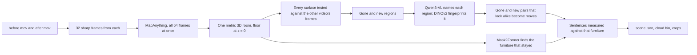

# What changed in the room

Give it two phone videos of the same room, filmed before and after you rearranged it. It builds one 3D model from both, finds what moved, what is new and what is gone, and says so in plain sentences. A viewer at `/changes` in the web app shows the shared model with every change boxed, the photos it came from and the parts of the room that only one video saw.


## Run it

You need macOS on Apple silicon (the local vision model runs on MLX), [uv](https://docs.astral.sh/uv/), ffmpeg and Node 20.9+. The first run downloads about 15 GB of model weights into `~/.cache`.

```bash
scripts/changes/setup.sh                       # builds packages/changes/.venv with the models' dependencies

packages/changes/.venv/bin/room-changes run before.mov after.mov \
  --out apps/web/public/changes/my-room         # about two minutes on an M-series laptop

cd apps/web && npm run dev                      # then open http://localhost:3000/changes?room=my-room
```

The terminal prints the same sentences the viewer shows:

```text
5 things changed between the videos: the armchair moved 3.0 m, the wooden stool moved 3.2 m, the potted plant was removed, a cardboard box appeared and a bamboo basket appeared.
  c1  moved    The armchair moved 3.0 m from between the bookshelf and the coffee table to the other side of the coffee table and turned about 150° clockwise. (about 1.0 m by 1.0 m and 95 cm tall)
  c2  moved    The wooden stool moved 3.2 m from near the coffee table to beside the bookshelf. (about 45 cm by 45 cm and 35 cm tall)
  c3  removed  The terracotta pot with green leaves beside the bookshelf is gone. (about 60 cm by 60 cm and 1.3 m tall)
  c4  added    A brown cardboard box appeared beside the coffee table. (about 60 cm by 45 cm and 25 cm tall)
  c5  added    A light brown bamboo basket appeared on the coffee table. (about 40 cm by 30 cm and 20 cm tall)
```

| Option | What it does |
|---|---|
| `--frames 32` | Frames taken from each video, each the sharpest of its stretch. More frames cost time and rarely help past 40. |
| `--fov 69` | The video's horizontal field of view in degrees, if you know it. Pinning it improved every score on the example; left out, the model estimates it. |
| `--namer none` | Skip the vision model. Changes are still found and measured, but every one is called "object". |
| `--fresh` | Reconstruct again instead of reusing the cached result in `~/.cache/sp-changes`. |

### Filming your own pair

Walk slowly around the room at chest height, about 15 to 30 seconds each, and keep the floor in frame. The second video should cover the same area from a different path; anything only one video saw is reported as a blind spot, not as a change. Move, add or remove objects at least 15 cm across, since thinner ones are filtered out (see the tradeoffs below).

## The example

[`datasets/changes/living-room`](../../datasets/changes/living-room) holds the example pair: two six-second handheld walkthroughs of a furnished room, rendered in Blender from CC0 Poly Haven models by [`scripts/changes/render_example_room.py`](../../scripts/changes/render_example_room.py). Between them an armchair and a stool moved, a floor plant was taken away, and a box and a basket appeared. The second video walks a different path from the first. Its output is checked in at [`apps/web/public/changes/living-room`](../../apps/web/public/changes/living-room).

A rendered room comes with exact answers, so the result can be scored. `truth.json` records every object's box in both videos and every camera pose. `room-changes evaluate` lines the estimated camera path up with the true one and matches each true change to a reported one of the same type within 50 cm:

```bash
packages/changes/.venv/bin/room-changes evaluate apps/web/public/changes/living-room datasets/changes/living-room/truth.json
```

| Measure | Result |
|---|---|
| Changes found | 5 of 5, with the right type |
| False alarms | 0 |
| Names that match the object | 5 of 5 |
| Mean box position error | 3.5 cm |
| Armchair turn | 150° reported, 160° true |
| Camera path error after alignment | 1.9 cm |
| Metric scale | 12% too large (see below) |

The example is rendered, not filmed. Rendering it was the only way to get exact ground truth, and it makes no claim about accuracy on real phone footage, which has motion blur, auto exposure and rolling shutter that the render lacks. The pipeline runs on real videos unchanged; recording a real before and after pair and adding it beside this one is the obvious next step.

## How it works



1. **One reconstruction, not two.** All frames from both videos go through [MapAnything](https://github.com/facebookresearch/map-anything) in a single pass. The furniture that did not move ties the two walks together, so there is no separate registration step to get wrong, and the depth, camera poses and scale are shared. The room is then turned so the floor sits at z = 0 and the walls line up with the axes.
2. **Seeing through, not just differencing.** Each surface point from the before video is projected into every after frame. If the after camera's depth lands on the point, it is still there. If the camera saw farther than the point, its line of sight passed through where the point was, which is evidence the thing is gone. If something nearer blocked the view, or no frame pointed that way, the after video says nothing about the point. The same test runs the other way for new things. This three-way answer is what keeps occlusion and gaps in coverage from turning into false changes; the viewer hatches those blind spots instead.
3. **Regions.** Points with repeated see-through evidence are grouped into connected regions, grown through neighbours the other video never contradicted, and fitted with upright boxes.
4. **Names and matches.** Qwen3-VL, running locally, names each region from its clearest frame. DINOv2 turns the region's pixels into an appearance fingerprint. A gone region and a new region that look alike, are of similar size and sit at least 15 cm apart become one move; the turn is the yaw that best lays the old shape onto the new one.
5. **Words from geometry.** Mask2Former labels the furniture in the before frames, those labels are voted onto the 3D points, and each unchanged piece gets a box. Phrases like "on the coffee table" or "to the other side of the coffee table" are computed from boxes, so a sentence can never place an object somewhere the 3D model does not.

## Tradeoffs

- **Free-space evidence needs a second look.** A change counts only where the other video actually saw through the old or new spot, at least twice. That keeps false alarms down but means a change the second video never pointed at goes unreported. The viewer and `coverage` in `scene.json` say how much of each video the other one re-checked (97% and 83% on the example).
- **Thin and small things are filtered out.** Regions under 10 cm thick across their footprint, or under about 150 surface points, are dropped. On the example every false alarm before these filters was a sliver along a silhouette, where the two reconstructions disagree by a pixel or two. A broom or a frame leaning on a wall would be missed.
- **Distances inherit the reconstruction's scale.** MapAnything predicts metric depth, but on the example it came out 12% large even with the field of view given (18% without), so "moved 3.0 m" is really about 2.7 m. Box positions relative to the room are accurate to a few centimetres because that error is a uniform scale. A known length in the room would fix it, and is not yet an option.
- **Pixels at the frame edge and within 40 cm of the lens are ignored.** Depth there was the source of the last false alarm on the example.
- **Turns are reported only when the shape decides them.** A stool or a box looks the same after a quarter turn, so the stool's 30° turn is not mentioned at all rather than guessed.
- **The vision model is local and Apple-only.** Qwen3-VL runs through MLX. On other machines `--namer none` still finds, boxes and measures every change and describes where it is against the furniture.

## Outputs

`--out` gets `scene.json` (the summary, every change with its boxes, sentence, evidence counts and crops, the furniture, coverage and the cameras), `cloud.bin` (both videos' points with colour, video, blind-spot flag and change id, laid out as described in `scene.json`), `pictures/` (before and after crops of each change) and small H.264 copies of the two videos for the viewer.

## Tests

The geometry, evidence test, regions, matching, furniture relations and sentences have unit tests that need only numpy and scipy, so they run in the repository's normal suite:

```bash
.venv/bin/python -m pytest packages/changes/tests
```
