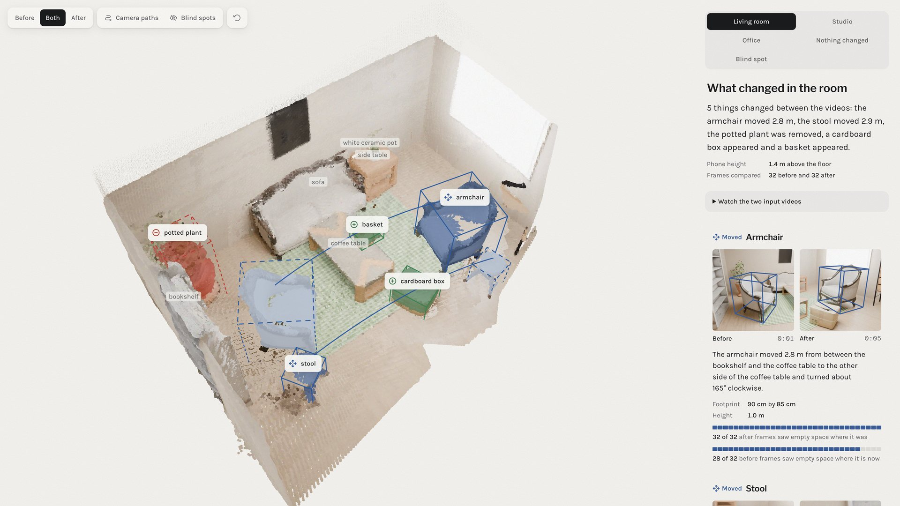
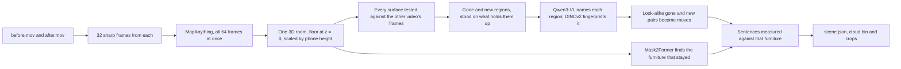

# What changed in the room

Give it two phone videos of the same room, one filmed before you rearranged it and one after. It builds a single 3D model from both and finds the things that moved, appeared or disappeared, then describes each one in a plain sentence. The viewer at `/changes` in the web app shows the shared model with every change boxed, the photos each box came from, and the parts of the room that only one video saw.



## Run it

You need macOS on Apple silicon (the local vision model runs on MLX), [uv](https://docs.astral.sh/uv/), ffmpeg and Node 20.9+. The first run downloads about 15 GB of model weights into `~/.cache`.

```bash
scripts/changes/setup.sh                       # builds packages/changes/.venv with the models' dependencies

packages/changes/.venv/bin/room-changes run before.mov after.mov \
  --camera-height 1.4 \
  --out apps/web/public/changes/my-room         # two to four minutes on an M-series laptop

cd apps/web && npm run dev                      # then open http://localhost:3000/changes?room=my-room
```

The terminal prints the same sentences the viewer shows. This is the living-room example:

```text
5 things changed between the videos: the armchair moved 2.8 m, the stool moved 2.9 m, the potted plant was removed, a cardboard box appeared and a basket appeared.
  c1  moved    The armchair moved 2.8 m from between the bookshelf and the coffee table to the other side of the coffee table and turned about 165° clockwise. (about 90 cm by 85 cm and 1.0 m tall)
  c2  moved    The stool moved 2.9 m from near the coffee table to beside the bookshelf. (about 45 cm by 40 cm and 45 cm tall)
  c3  removed  The green leafy plant in terracotta pot beside the bookshelf is gone. (about 55 cm by 55 cm and 1.3 m tall)
  c4  added    A beige cardboard box appeared beside the coffee table. (about 55 cm by 45 cm and 35 cm tall)
  c5  added    A woven natural fibre basket appeared on the coffee table. (about 35 cm by 30 cm and 15 cm tall)
```

| Option | What it does |
|---|---|
| `--camera-height 1.4` | How high you held the phone, in metres. It corrects the reconstruction's scale, which otherwise ran 6 to 17% large on the examples. Leave it out if you don't know. |
| `--fov 69` | The video's horizontal field of view in degrees, if you know it. Left out, the model estimates it. |
| `--rotate 90` | Turn every frame clockwise by this many degrees, for a video that doesn't record which way is up. Videos from the iPhone camera app do. |
| `--frames 32` | Frames taken from each video, each the sharpest of its stretch. |
| `--namer none` | Skip the vision model. Changes are still found, boxed and placed against the furniture, but each one is called "object". |
| `--fresh` | Reconstruct again instead of reusing the cached result in `~/.cache/sp-changes`. |

### Filming your own pair

Walk slowly around the room at chest height for 15 to 30 seconds, keeping the floor in frame. Film the second video on a different path but over the same area. A spot only one video saw is shown as a blind spot and never reported, so overlap matters more than length. Changes need to be at least about 10 cm across to count (see the tradeoffs).

To test on a walk you already have, `scripts/changes/capture_pair.py` cuts two stretches of one Standard Physics capture into an upright before and after pair, with ARKit's camera track as the truth for the scorer.

## Examples and how they score

Each example is a pair of six-second handheld walkthroughs rendered in Blender from CC0 Poly Haven models by [`render_example_room.py`](../../scripts/changes/render_example_room.py), using the rooms in [`example_scenes.py`](../../scripts/changes/example_scenes.py). The footage imitates a phone: the camera shakes and rolls, the shutter blurs motion and reads the sensor top to bottom, the exposure drifts, and the video carries grain and compression. The inputs live in [`datasets/changes`](../../datasets/changes), the outputs in [`apps/web/public/changes`](../../apps/web/public/changes), and the viewer switches between them.

Every rule in the detector was written against rooms it could see, so a room only tests the detector the first time it is scored. Four rooms were held out that way. Each was rendered after the detector was frozen, scored once, and its first score saved unedited in [`held-out`](held-out), with the fingerprint of the detector that made it. Each first run turned up mistakes, the fixes were checked against every room, and the room then became a development example. The first runs are the honest measure of how the detector does on a room it has never seen:

| First run | Detector | Found | False alarms | Names exactly right | What it led to |
|---|---|---|---|---|---|
| [Office](held-out/office-first-run.json) | `590b3d4af243` | 3 of 5, 1 partly, 1 never in view | 0 | 1 of 3 | Scoring a change neither video saw as unobservable, not missed |
| [Bedroom](held-out/bedroom-first-run.json) | `a6be5c8aefba` | 5 of 5 | 1, a bed post | 1 of 5 | Dropping leftovers of added regions; plural grammar |
| [Kitchen](held-out/kitchen-first-run.json) | `6eeaae48a55e` | 5 of 5 | 1, half of the moved chair | 1 of 5 | Joining one object split into two regions |
| [Workshop](held-out/workshop-first-run.json) | `2104cbd57afb` | 3 of 5, 1 partly, 1 missed | 1, the second of two suitcases | 3 of 3 | A noun's number read from its head word |

Across the four first runs, 16 of 20 changes were found with a box covering the object and 2 more partly. One was never in view of one video, and one, the workshop's jerry can, was missed. Of the 21 changes reported, 3 were false alarms. The scorer counts a name right only when it is on a short list of synonyms that is never widened after seeing a result. The workshop's labels were added to that list before it was rendered; the bedroom's and kitchen's never were, so for them only the exact label counts, and "oil drum" for a barrel is scored wrong. A second figure, the head-noun score, checks only the last word, which is the kind of thing.

The workshop first run is the only one made with the support rule and two-view naming described below. Both came from the bedroom: the bed post hung in the air, and the basket on the nightstand was named "white ceramic plates" from one view. In the workshop all three names it scored were right, and nothing was set aside as hanging. Its suitcase model turned out to be a pair of suitcases, which the truth file boxes as one object. The detector reported two suitcases, so the scorer counts one partial find and one false alarm.

Every checked-in result now comes from one detector, recorded in each `scene.json`:

| Room | What it tests | Found | False | Exact names | Right kind |
|---|---|---|---|---|---|
| Living room | Two moves, a removal and two additions, one of them on a table | 5 of 5 | 0 | 5 of 5 | 5 of 5 |
| Studio | A second room, furniture and pair of paths | 4 of 5, 1 partly | 0 | 4 of 4 | 4 of 4 |
| Office | Held out first; the plastic container was never in view of the before video | 3 of 5, 1 partly | 0 | 1 of 3 | 3 of 3 |
| Bedroom | Held out first; a moved chair and barrel, a trash bag, and a basket set on the nightstand | 5 of 5 | 0 | 2 of 5 | 3 of 5 |
| Kitchen | Held out first; a moved plastic chair and stool, a barrel taken away | 5 of 5 | 0 | 1 of 5 | 4 of 5 |
| Workshop | Held out first; a moved tool cart and school chair, suitcases set on the desk | 3 of 5, 1 partly | 1 | 3 of 3 | 3 of 3 |
| Nothing changed | The living room twice from different paths | Nothing reported | 0 | | |
| Blind spot | The before walk never looks at half the room, and a crate appears there | The armchair's move; the crate listed as seen by one video only | 0 | 1 of 1 | 1 of 1 |

A rendered room comes with exact answers. `truth.json` records every object's box in both videos and every camera pose, and `room-changes evaluate` scores a result against it. It lines the estimated camera path up with the true one and matches each true change to a reported one of the same type within 50 cm whose box covers at least a quarter of the object; a report nearby that covers less is counted as partial. It also checks three things about what is not reported. Every piece of furniture a sentence can cite must stand where a real unchanged object stands. Nothing listed as seen by one video only may be an unchanged object. And nothing set aside as hanging in the air may sit where a real change happened. Errors are measured in the reconstruction's own metres, after the camera-height correction, as a person reading the sentences would meet them. The figures below average every before and after box:

```bash
packages/changes/.venv/bin/room-changes evaluate apps/web/public/changes/workshop datasets/changes/workshop/truth.json
```

| Measure | Office | Bedroom | Kitchen | Workshop | Living room | Studio |
|---|---|---|---|---|---|---|
| Box centre error on the floor | 3.3 cm | 4.6 cm | 4.7 cm | 7.0 cm | 4.9 cm | 8.2 cm |
| Box bottom error | 1.8 cm | 1.7 cm | 2.3 cm | 1.5 cm | 2.0 cm | 2.7 cm |
| Box height error | 1.7 cm | 1.8 cm | 2.7 cm | 5.1 cm | 4.5 cm | 2.7 cm |
| 3D overlap with the true box | 0.72 | 0.65 | 0.61 | 0.60 | 0.69 | 0.61 |
| Distance moved, error | 1.7 cm | 7.1 cm | 2.8 cm | 6.4 cm | 5.5 cm | 5.5 cm |
| Camera path error | 2.9 cm | 1.5 cm | 1.7 cm | 2.9 cm | 1.9 cm | 2.5 cm |

Turns are stated only when they can be checked. Where one is stated, it is within 5° of the truth, as for the living room's armchair, the studio's armchair, the bedroom's chair and the kitchen's plastic chair. A turn is left out when the shape search finds no clear best turn or the footprint disagrees with it, as for the office armchair, the studio ottoman and both moves in the workshop. It is also left out for anything round, such as a stool or a barrel, which looks the same however far it turned.

These misses are known and left in:

- In the office, the plastic container that appeared in the corner was in view in none of the before video's 96 frames, so nothing could say whether it was new, and the scorer lists it as unobservable rather than missed. The wooden crate beside both walks' paths was only partly seen. Its box covers that part and its sentence says so, but the vision model now calls it "a brown wooden suitcase".
- In the studio the before video only ever saw one end of the wooden crate, so its box overlaps the crate by 0.16 and the vision model called it "a wooden step"; the sentence ends "only part of it was ever in view, so it may be larger".
- In the bedroom, the truth file has a chair and a barrel moving, a planter box taken away, a trash bag set down, and a wicker basket set on the nightstand. The detector calls them a chair, an oil drum, a wooden crate, a plastic bag and a woven basket. Its first run also reported "a dark wooden bed post appeared", which did not happen. That box floats between 78 cm and 1.24 m above the floor with surface under only 62% of its footprint, where every real change has at least 86%. Boxes with less than 75% are now listed as not counted, with that reason. The cause of the bed post itself has not been pinned down.
- In the kitchen, the furniture list includes "a white plastic chair" beside the stove, where no chair stands; both the segmenter and the vision model took part of the white stove for one. The viewer labels only furniture a sentence cites, and a change is never placed against furniture of its own kind, so nothing shows or cites it. The sack was named "a gray metal bucket", which is wrong.
- In the workshop, the jerry can that was taken away is missed. Of the 270 points on its surface, the after video saw through 105 and its depth agreed with 108, so the spot was about half empty, far short of the 85% a region needs. The desk is missing from the furniture list, so the suitcases on it are placed "near the bookshelf", which is the metal rack.

[`tests/test_change_examples.py`](tests/test_change_examples.py) re-scores all eight checked-in results on every test run, including that each was made by the same detector. It checks what is found, partial and not counted, how many false alarms there are, both name scores, which changes are worded as partly seen, which furniture stands on no real object, and that nothing set aside was a real change. The known misses above are pinned as numbers, so a fix shows up as a failing test to update and a regression as a failing test to fix.

### Real phone footage

The rendered rooms are the only footage with exact answers. As a check on real video, two pairs of stretches were cut from the Share Tea walkthrough, a real iPhone capture of a shop that is kept out of this repository, using `capture_pair.py`. Nothing was staged within either pair. ARKit's camera track and the RoomPlan floor give true metres and the true phone height, so both pairs score the reconstruction and count false alarms. Their scores, without any imagery, are in [`real-footage`](real-footage).

| Pair | What it was used for | Camera path error | Scale error with a 1.4 m phone height | Reported |
|---|---|---|---|---|
| Counter, at 168 s and 198 s | Tuning: it led to the 85% rule | 8.9 cm | 2.8% (17% with no height given) | Nothing |
| Shop, at 69 s and 104 s | Development: run as the detector changed, but no rule was tuned on it | 13.3 cm | 2.6% | Nothing; one box not counted |

On the counter, the first version of the detector reported two open-frame bar stools as removed. From some angles the after video sees through the gaps between a stool's rails, so it reads as partly empty; requiring 85% of all sightlines into a region to see empty space removed both. The shop pair used to report "a black computer monitor appeared", which did not happen. The monitor is in both videos and stands in front of a glass display case. The before video's depth most likely went through the glass to the case's back, so the monitor's spot read as empty. The support rule, which was set on the bedroom alone, now lists it as not counted: "a black computer monitor seems to have appeared 1.5 m above the floor with nothing under most of it". On both real pairs the walks overlap less than the rendered ones, and the "seen by one video only" entries name the chairs and stools that one walk filmed and the other did not; people passing through are left out. A real pair with staged changes and hand-measured truth is the next example to add.

## How it works



1. **One reconstruction, not two.** All frames from both videos go through [MapAnything](https://github.com/facebookresearch/map-anything) in a single pass. The furniture that did not move ties the two walks together, so there is no separate registration step to get wrong. The room is turned so the floor sits at z = 0 and the walls line up with the axes, and the phone's median height above the floor rescales it to the height you gave.
2. **Seeing through, not differencing.** Each surface point from the before video is projected into every after frame. If the after camera's depth lands on the point, the surface is still there. If the camera saw farther than the point, its line of sight passed through where the point was, which is evidence that it is gone. If something nearer blocked the view, or no frame pointed that way, the after video says nothing about the point. The same test runs the other way for new things. This third answer is what keeps a different viewpoint, an occluded corner or a spot only one video saw from turning into a change, and the viewer hatches those spots instead.
3. **Regions.** Points that several frames saw through are grouped into connected regions, grown through neighbours the other video never contradicted, and fitted with upright boxes. A region survives only if 85% of all sightlines into it saw empty space. Its box then stands on the floor or the table top underneath, because within about 15 cm of a support depth can't tell an object's base from what it rests on. A raised box with unchanged surface under less than 75% of its footprint hangs in the air, which real things don't, so it is listed as not counted instead of reported.
4. **Names and matches.** Qwen3-VL, running locally, names each region from its two clearest frames at once, so one misleading angle can't decide the name. DINOv2 turns the region's pixels into an appearance fingerprint. A gone region and a new one that look alike, are of similar size and sit at least 15 cm apart become one move. A leftover piece of the same kind touching either end joins that end, so one chair seen in two pieces stays one chair, and an end whose box lost its legs takes the other end's height. The turn is the yaw that best lays the old shape onto the new one. It is left out when the shape looks the same turned, when the shape and the footprint disagree, and for round things such as stools and drums.
5. **Not counted.** A clump of surface that only one video saw, standing where almost nothing around it was checked either, is listed under "Not counted as changes" instead of being reported, with a sentence saying which video saw it. The hidden back of a sofa is also unseen, but the sofa around it was seen by both, so it is not listed.
6. **Words from geometry.** Mask2Former labels the furniture in the before frames, the labels are voted onto the 3D points, and each unchanged piece gets a box and a name nothing else in the room shares. "On the coffee table", "between the bookshelf and the coffee table" and "to the other side of the coffee table" are computed from those boxes, so a sentence never places an object somewhere the 3D model does not. A change is never placed against furniture of its own kind, since "the chair moved from beside the chair" tells the reader nothing.

## Tradeoffs

- **A change needs a second look.** It counts only where the other video saw through the old or new spot, from several frames. That keeps false alarms down, but a change the second video never pointed at goes unreported. `coverage` in `scene.json` and the bars in the viewer say how much of each video the other one checked.
- **Thin and small things are filtered out.** Regions under 10 cm across their footprint or under about 150 surface points are dropped, along with pixels at the frame edge and within 40 cm of the lens. Each of these filters removed a false alarm on the living room, where every one was a sliver along a silhouette or a smear at the frame edge. A broom or a frame leaning on a wall would be missed.
- **The scale needs a hint.** MapAnything predicts metric depth, but its scale came out 6 to 11% large on the rendered rooms and 17% large on the real counter. A phone height is easy to know and fixes most of that; a measured length in the room would fix the rest, and is not an option yet.
- **Glass, mirrors and screens can fake a change.** Depth through glass lands behind it, so an object in front of a display case can read as new or gone. The support rule catches it when the object hangs in the air, as the shop's monitor did, but not when it stands on the floor.
- **Repeated open-frame furniture is hard.** Stools and chairs made of thin rails read as partly empty from some angles. The 85% rule handles the real counter above, but a pair of chairs swapped for identical ones would not be seen as a change at all.
- **The vision model is local and Apple-only.** Qwen3-VL runs through MLX. On other machines `--namer none` still finds and measures every change and places it against the furniture.

## Outputs

`--out` gets `scene.json` (the summary, every change with its boxes, sentence, evidence and crops, the furniture, coverage, cameras and the scale used), `cloud.bin` (both videos' points with colour, video, blind-spot flag and change id, laid out as `scene.json` describes), `pictures/` (before and after crops of each change) and small H.264 copies of the two videos for the viewer.

## Tests

The geometry, evidence test, regions, matching, furniture relations and sentences have unit tests that need only numpy and scipy, and the eight examples are re-scored, all in the repository's normal suite:

```bash
.venv/bin/python -m pytest packages/changes/tests
```
